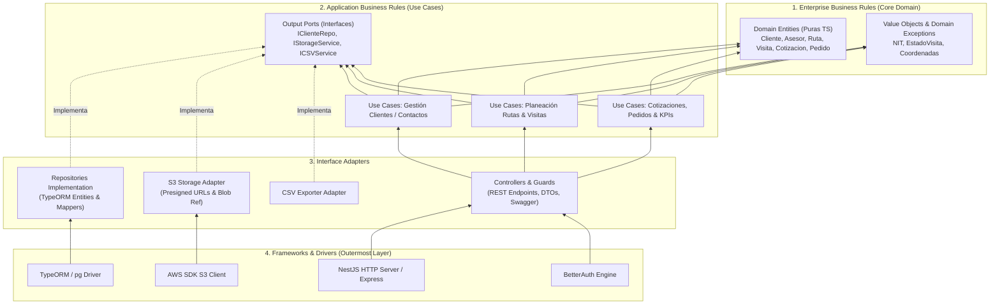

# Guía Integral de Ingeniería para Épicas e Historias de Usuario — Comercial 360

> **Documento de Análisis Arquitectónico, Metodológico y Técnico**  
> Basado en la biblioteca del cuaderno **TS** (*Clean Architecture*, *DDD* de Evans y Vernon, *Fullstack TypeScript*, *Node.js Design Patterns*, *Node.js Auth & Best Practices*, *Understanding Distributed Systems*, *Continuous Delivery con Docker y Jenkins*, *Complete NGINX Cookbook*, *Dive into Design Patterns*, *The Lean Startup*) cruzado con [Comercial360_Historias_de_usuario.docx](file:///home/alejandro/Developer/proyecto-comercial360/Comercial360_Historias_de_usuario.docx) y los 3 diagramas de [diagramas.md](file:///home/alejandro/Developer/proyecto-comercial360/diagramas.md).

---

## Índice

1. [Fuentes de la Biblioteca "TS" Aplicadas al Proyecto](#1-fuentes-de-la-biblioteca-ts-aplicadas-al-proyecto)
2. [Principios Metodológicos sobre Épicas e Historias de Usuario (Según tus Libros)](#2-principios-metodológicos-sobre-épicas-e-historias-de-usuario-según-tus-libros)
3. [Análisis Cruzado de los 3 Diagramas (`diagramas.md`) vs. Documento de Historias (`.docx`)](#3-análisis-cruzado-de-los-3-diagramas-diagramasmd-vs-documento-de-historias-docx)
   - [3.1. Diagrama 1: Clean Architecture (4 Capas)](#31-diagrama-1-clean-architecture-4-capas)
   - [3.2. Diagrama 2: Infraestructura en AWS, Nginx, Docker y Jenkins](#32-diagrama-2-infraestructura-en-aws-nginx-docker-y-jenkins)
   - [3.3. Diagrama 3: Flujo de Datos de URL Autorizada (Presigned URLs en S3)](#33-diagrama-3-flujo-de-datos-de-url-autorizada-presigned-urls-en-s3)
4. [Alertas Críticas: Desalineaciones entre `diagramas.md` y `Comercial360_Historias_de_usuario.docx`](#4-alertas-críticas-desalineaciones-entre-diagramasmd-y-comercial360_historias_de_usuariodocx)
5. [Guía Detallada por Épica e Historia de Usuario (Épica 0 a Épica 8 · HU-01 a HU-24)](#5-guía-detallada-por-épica-e-historia-de-usuario-épica-0-a-épica-8--hu-01-a-hu-24)
   - [Épica 0 · Infraestructura y Arquitectura (`HU-01` a `HU-04`)](#épica-0--infraestructura-y-arquitectura-hu-01-a-hu-04)
   - [Épica 1 · Datos Base (`HU-05`)](#épica-1--datos-base-hu-05)
   - [Épica 2 · Gestión de Clientes — Director (`HU-06` a `HU-08`)](#épica-2--gestión-de-clientes--director-hu-06-a-hu-08)
   - [Épica 3 · Autenticación y Roles (`HU-09` a `HU-11`)](#épica-3--autenticación-y-roles-hu-09-a-hu-11)
   - [Épica 4 · Planeación de Rutas — Director (`HU-12` a `HU-14`)](#épica-4--planeación-de-rutas--director-hu-12-a-hu-14)
   - [Épica 5 · Agenda y Visitas — Asesor (`HU-15` a `HU-18`)](#épica-5--agenda-y-visitas--asesor-hu-15-a-hu-18)
   - [Épica 6 · Gestión Comercial (`HU-19` a `HU-21`)](#épica-6--gestión-comercial-hu-19-a-hu-21)
   - [Épica 7 · Dashboard e Indicadores (`HU-22` y `HU-23`)](#épica-7--dashboard-e-indicadores-hu-22-y-hu-23)
   - [Épica 8 · Reportes (`HU-24`)](#épica-8--reportes-hu-24)
6. [Revisión de los Cambios al Modelo de Datos y Notas Técnicas (`N-1` a `N-6`)](#6-revisión-de-los-cambios-al-modelo-de-datos-y-notas-técnicas-n-1-a-n-6)
7. [Estrategia de Ejecución para los 7 Integrantes rumbo a la Sustentación (26 de Octubre)](#7-estrategia-de-ejecución-para-los-7-integrantes-rumbo-a-la-sustentación-26-de-octubre)

---

## 1. Fuentes de la Biblioteca "TS" Aplicadas al Proyecto

Tu cuaderno **TS** reúne 30 fuentes técnicas que cubren exactamente las decisiones de arquitectura, diseño de dominio, seguridad, infraestructura y producto de **Comercial 360**:

| Categoría | Libros / Fuentes en tu Cuaderno `TS` | Aplicación directa en Comercial 360 |
| :--- | :--- | :--- |
| **Arquitectura de Software** | • *Clean Architecture* (Robert C. Martin)<br>• *Fullstack TypeScript (Vol. 3)*<br>• *Plataforma de Gestión Comercial: Arquitectura* | Regla de Dependencia, separación de las 4 capas, *Humble Object Pattern*, *Presenters/ViewModels* e inyección de dependencias en NestJS (`HU-01`). |
| **Modelado de Dominio (DDD)** | • *Domain-Driven Design* (Eric Evans)<br>• *Implementing Domain-Driven Design* (Vaughn Vernon) | *Bounded Contexts*, *Entities* vs. *Value Objects* (`NIT`, `Coordenadas`, `EstadoVisita`), *Aggregate Roots*, transacciones ACID, *Domain Events* (`HU-21`) y *Use Case Optimal Queries* (`HU-22`, `HU-23`). |
| **Patrones y Runtime Backend** | • *Node.js Design Patterns* (Casciaro & Mammino)<br>• *Dive into Design Patterns* (Alexander Shvets)<br>• *The Node.js Best Practices List*<br>• *RESTful API Node TypeScript* | Procesamiento por *Streams* para CSV/Excel (`HU-07`, `HU-24`), control de concurrencia/throttling ante Nominatim (`N-2`), patrón *Strategy* en rutas (`Épica 4`) y patrón *Adapter* para S3/TypeORM. |
| **Sistemas Distribuidos y Red** | • *Understanding Distributed Systems* (Roberto Vitillo)<br>• *Complete NGINX Cookbook* / *NGINX HTTP Server* | Balanceo *Round-Robin* sin estado (*stateless*) entre réplicas NestJS, patrón *Reference + Blob* con *Presigned URLs* en S3, timeouts, *Circuit Breaker* e idempotencia. |
| **Seguridad y Autenticación** | • *Node.js Auth Security Best Practices (2026)*<br>• *RFC 7519 (JWT)* | Sesiones seguras con cookies `httpOnly`/`Secure`/`SameSite`, RBAC con *Guards* (`ASESOR` vs `DIRECTOR`), prevención de *IDOR* (`HU-10`, `HU-18`, `HU-22`). |
| **CI/CD, Contenedores y DevOps** | • *Continuous Delivery* (Jez Humble & David Farley)<br>• *Continuous Delivery with Docker and Jenkins* (Rafal Leszko)<br>• *Learning CI with Jenkins* & *Curso Docker* | Pipeline automatizado en Jenkins (`HU-03`), migraciones automatizadas (`HU-05`), paridad de entornos con Docker Compose y prevención de *OOM Killer* en EC2. |
| **Producto, Épicas y MVP** | • *The Lean Startup* (Eric Ries)<br>• *Product-Led Growth* (Wes Bush)<br>• *Historias de Usuario / Reglas de Negocio Riwi* | *Vertical Slicing* (historias de punta a punta por desarrollador), corte estricto de alcance MVP (*Obligatorias* vs. *Deseables*) y criterios *Given / When / Then*. |

---

## 2. Principios Metodológicos sobre Épicas e Historias de Usuario (Según tus Libros)

Antes de entrar al detalle técnico de cada historia, tus libros establecen **5 reglas de oro** para gestionar Épicas e Historias de Usuario en una arquitectura limpia con tiempo límite (sustentación el **lunes 26 de octubre de 2026**):

1. **Una Historia de Usuario = Un Caso de Uso de Aplicación (*Clean Architecture* + *DDD*):**
   - Robert C. Martin explica que los **Casos de Uso** (*Application Business Rules*) especifican exactamente cómo un actor interactúa con el sistema automatizado.
   - En [Comercial360_Historias_de_usuario.docx](file:///home/alejandro/Developer/proyecto-comercial360/Comercial360_Historias_de_usuario.docx), casi cada historia funcional (`HU-06` a `HU-24`) mapea 1 a 1 con un Caso de Uso en la carpeta `application/use-cases/` (ej. `HU-06` → `CrearClienteUseCase`, `HU-14` → `AsignarRutaUseCase`, `HU-17` → `RegistrarVisitaUseCase`).
   - **Qué tener en cuenta:** No pongas la lógica de la historia de usuario en el `Controller` ni dentro de un servicio gigante (`ClientesService` con 20 métodos). Crea una clase por Caso de Uso con un único método `execute(dto)`. Así, cada integrante del equipo trabaja en archivos separados y **se eliminan los conflictos de Git (*merge conflicts*)**.

2. **Épicas alineadas con *Bounded Contexts* (*Implementing DDD* — Vaughn Vernon):**
   - Tus 9 épicas están agrupadas por subdominios cohesivos (`auth`, `clientes`, `rutas`, `visitas`, `comercial`, `dashboard`, `reportes`, `archivos`).
   - **Qué tener en cuenta:** Un módulo no debe importar directamente los repositorios de TypeORM de otro módulo. Si `Visitas` (`HU-17`) necesita crear una `Cotización` (`HU-19`), un `Pedido` (`HU-19`), un `Seguimiento` (`HU-20`) y una entrada en `HISTORIAL_CLIENTE` (`HU-21`), debe hacerlo a través de **Puertos (Interfaces) inyectados** o **Eventos de Dominio** dentro de la misma unidad de trabajo transaccional.

3. **Corte Vertical (*Vertical Slicing*) y Reducción de Desperdicio (*The Lean Startup* — Eric Ries):**
   - El documento `.docx` toma una decisión excelente en la **Sección 1 (Alcance)**: congela como *Fuera de alcance* 10 pantallas secundarias del menú lateral y el detalle de productos (`COTIZACION_DETALLE`), concentrando los **81 puntos obligatorios** en las **4 pantallas diseñadas + la pantalla Clientes del Director**.
   - **Qué tener en cuenta:** Según *The Lean Startup*, cualquier código escrito para pantallas fuera de alcance es desperdicio (*waste*) que pone en riesgo la sustentación. El menú lateral debe renderizar todos los ítems por fidelidad visual al mockup, pero con estado deshabilitado (`disabled` / tooltip `"Próximamente"`) para las vistas fuera de alcance.

4. **Desbloqueo del Equipo mediante Contratos y *Test Doubles* (*Clean Architecture* & *Continuous Delivery*):**
   - El calendario de la Sección 5 dice: *"Lun 19 – Mar 20: HU-01, HU-05 y la infraestructura creada. Nadie programa funcionalidades antes de tener la estructura base y las migraciones"*.
   - **Matiz clave según Uncle Bob (*Clean Architecture*):** Esperar a que exista la estructura base (`HU-01`) es correcto para no romper convenciones, pero **nadie debería quedar bloqueado si RDS o las migraciones (`HU-05`) tardan unas horas más**. Como `domain/` y `application/` solo dependen de interfaces (`IClienteRepository`), los desarrolladores pueden escribir desde el primer día sus Entidades, Value Objects, Casos de Uso y DTOs de Swagger probándolos con repositorios en memoria (*In-Memory Repositories* / *Mocks*).

5. **Criterios de Aceptación Deterministas (*Given / When / Then* — *Continuous Delivery*):**
   - Jez Humble y David Farley recalcan que un criterio de aceptación en formato *Dado / Cuando / Entonces* es una **especificación ejecutable**. Cada criterio del `.docx` (por ejemplo, devolver `403 Forbidden` cuando un `ASESOR` llama a un endpoint exclusivo del `DIRECTOR`, o rechazar un NIT duplicado en `HU-06` pero actualizarlo en `HU-07`) debe convertirse en un test unitario del Caso de Uso y en una prueba en Swagger antes del viernes 23.

---

## 3. Análisis Cruzado de los 3 Diagramas (`diagramas.md`) vs. Documento de Historias (`.docx`)

### 3.1. Diagrama 1: Clean Architecture (4 Capas)

En [diagramas.md](file:///home/alejandro/Developer/proyecto-comercial360/diagramas.md#L1-L35), el primer diagrama modela las 4 capas concéntricas de Robert C. Martin desde afuera hacia adentro (`flowchart BT`):



#### Cómo conectar el Diagrama 1 con `HU-01` del `.docx`:
En `HU-01` del documento `.docx`, cada módulo tiene 4 carpetas: `domain/`, `application/`, `infrastructure/` y `presentation/`. Durante la sustentación y en el código, deben tener clara esta equivalencia exacta:
- **`domain/`** = **Capa 1 (Enterprise Business Rules)**: Contiene las Entidades puras de TypeScript (`Cliente`, `Ruta`, `Visita`, `Cotizacion`, `Pedido`) y los *Value Objects* (`NIT`, `EstadoVisita`, `Coordenadas`) más las excepciones de dominio (`NitDuplicadoDomainException`, `RutaSinParadasDomainException`). **Cero imports** de `@nestjs/*`, `typeorm` o `@aws-sdk/*`.
- **`application/`** = **Capa 2 (Application Business Rules)**: Contiene los Casos de Uso (`CrearClienteUseCase`, `RegistrarVisitaUseCase`, etc.), DTOs de entrada/salida de aplicación y los **Output Ports** (`IClienteRepository`, `IStorageService`, `ICSVService`, `IGeocodingService`). Aquí se aplica el **Principio de Inversión de Dependencias (DIP)**: `application/` define la interfaz del puerto y `infrastructure/` la implementa.
- **`presentation/` + `infrastructure/`** = **Capas 3 (Interface Adapters) y 4 (Frameworks & Drivers)**:
  - `presentation/` aloja los `Controllers`, `Guards` de roles (`RolesGuard` conectado a BetterAuth), DTOs HTTP validados con `class-validator` y decoradores `@ApiProperty()` de Swagger.
  - `infrastructure/` aloja las Entidades de TypeORM (`@Entity()`), los **Mappers** (`ClienteMapper.toDomain()` y `ClienteMapper.toPersistence()`), los Repositorios concretos de TypeORM, el adaptador de AWS S3 (`S3StorageAdapter`), el lector/exportador de CSV/Excel y el cliente HTTP de Nominatim.

---

### 3.2. Diagrama 2: Infraestructura en AWS, Nginx, Docker y Jenkins

En [diagramas.md](file:///home/alejandro/Developer/proyecto-comercial360/diagramas.md#L44-L90), el segundo diagrama define la topología de despliegue en AWS (`flowchart RL`):

- **Instancia AWS EC2 (Ubuntu / Docker Host):**
  - **Nginx (Puertos 80 / 443):** Actúa como *Reverse Proxy* y *Load Balancer* (*Round Robin*). Enruta `/*` hacia el contenedor de la **SPA (Frontend)** y `/api/*` hacia las réplicas del backend **NestJS (`API1`..`APIN`)**.
  - **Jenkins Server (Puerto 8080 / Docker Socket):** Vive dentro de la misma instancia EC2 (requisito obligatorio de `HU-03`), recibe el *Webhook* de GitHub tras un `git push` a `main`, ejecuta `Pull, Test & Build` y levanta los contenedores con `docker compose up -d --build`.
- **Servicios Administrados AWS (Managed Services):**
  - **Amazon RDS PostgreSQL:** Conectado por TCP `5432` únicamente desde las réplicas de NestJS vía TypeORM.
  - **Amazon S3 Bucket:** Conectado desde el backend con **AWS SDK v3** (para firmar *Presigned URLs* o subir respaldos/CSV) y desde el navegador del cliente mediante subida/descarga directa (*Presigned URLs*).
- **Servicios Externos:**
  - **OpenStreetMap API / Tiles:** El navegador descarga los *tiles* del mapa con Leaflet, y el backend geocodifica direcciones con Nominatim (`N-2`).

#### Qué exigen tus libros sobre este Diagrama 2:
1. **Peligro de *OOM Killer* en la EC2 (*Continuous Delivery with Docker and Jenkins* — Leszko):**
   - Ejecutar Jenkins (JVM de Java) + compilación de TypeScript (`tsc` de NestJS y build de React/Vite/Next) + múltiples réplicas de NestJS en la misma instancia EC2 agotará la memoria RAM si la instancia es `t2.micro`, `t3.small` o `t3.medium`, congelando el servidor en plena sustentación.
   - **Acción obligatoria:** Configurar un **archivo Swap de 4 GB** en Ubuntu (`fallocate -l 4G /swapfile`) apenas aprovisionen la EC2, y en desarrollo/sustentación limitar las réplicas de NestJS en `docker-compose.yml` a `2` instancias con límites de memoria definidos.
2. **Aislamiento de Red y Security Groups (*Understanding Distributed Systems* & *Complete NGINX Cookbook*):**
   - El puerto `3000` de NestJS **jamás** debe abrirse en el Security Group de la EC2; solo debe ser accesible dentro de la red interna de Docker por Nginx.
   - El Security Group de **RDS (`5432`)** solo debe aceptar tráfico entrante cuyo origen sea el **Security Group de la EC2** (`sg-xxxx`), más las IPs de los desarrolladores si hacen pruebas locales temporales (`HU-02`).
3. **Réplicas Stateless detrás de Nginx (*Understanding Distributed Systems*):**
   - Como el Diagrama 2 tiene `API1` y `API2` balanceados por *Round Robin* en Nginx, **ningún estado puede guardarse en memoria RAM ni en el disco local del contenedor**:
     - Las sesiones de BetterAuth se persisten en PostgreSQL (RDS).
     - Los archivos subidos van a S3 (nunca a una carpeta `./uploads` local del contenedor).

---

### 3.3. Diagrama 3: Flujo de Datos de URL Autorizada (Presigned URLs en S3)

En [diagramas.md](file:///home/alejandro/Developer/proyecto-comercial360/diagramas.md#L92-L128), el diagrama de secuencia ilustra el patrón **Reference + Blob con Presigned URLs**:
- **Flujo 1 (Subida):**
  1. El navegador envía metadatos en JSON al backend (`Nginx -> NestJS`).
  2. El Caso de Uso genera un `s3Key` único, guarda la referencia en RDS PostgreSQL y solicita al `StorageAdapter` una **Presigned PUT URL** firmada localmente con `@aws-sdk/s3-request-presigner`.
  3. El backend responde `201 Created` con `{ s3Key, uploadUrl }`.
  4. El navegador ejecuta `PUT <uploadUrl>` enviando el binario directamente a Amazon S3 (`Content-Type: application/pdf` o `image/jpeg`).
- **Flujo 2 (Visualización / Descarga):**
  1. El navegador solicita acceso al documento (`GET /api/...`).
  2. El backend verifica permisos (BetterAuth), consulta el `s3_key` en RDS y firma una **Presigned GET URL** que expira en 5 minutos (`expiresIn: 300`).
  3. El navegador abre o descarga el archivo directamente desde S3 usando `downloadUrl`.

---

## 4. Alertas Críticas Resueltas: Alineación Definitiva entre `diagramas.md` y `Comercial360_Historias_de_usuario.docx`

Al cruzar palabra por palabra el documento `.docx` con `diagramas.md`, se identificaron **4 discrepancias arquitectónicas**. A continuación se presentan las decisiones tomadas y la resolución canónica oficial para el desarrollo del proyecto:

| # | Punto de fricción | Qué decía cada documento | Decisión y Resolución Canónica Oficial (Elegida e Implementada) |
| :- | :--- | :--- | :--- |
| **1** | **Subida de adjuntos a S3 (`HU-04` vs Diagrama 3)** | `diagramas.md`: Presigned PUT URLs directas a S3.<br>`.docx`: `POST /visitas/:id/adjuntos (multipart)`. | **RESOLUCIÓN ADOPTADA: Opción A (Presigned PUT URL Directa a S3).**<br>El backend no recibe binarios en `HU-04`. El endpoint `POST /api/visitas/:id/adjuntos` recibe únicamente un JSON con metadatos (`{ nombreOriginal, tipoMime, tamano }`), valida que sea `jpg/png/pdf <= 10MB`, registra la fila en la tabla `ADJUNTO` (`N-1`) y retorna `{ idAdjunto, s3Key, uploadUrl }`. El frontend hace un `fetch(uploadUrl, { method: 'PUT', body: file })` directo a S3. Esto evita saturar el Event Loop y la RAM en la EC2, protege contra el límite por defecto de Nginx y elimina buffers pesados en NestJS. |
| **2** | **Referencia de archivos en BD y alcance comercial** | `diagramas.md`: Ejemplifica con `cotizacion_detalle` y `cotizacion.s3_key`.<br>`.docx`: `COTIZACION_DETALLE` fuera de alcance; crea la tabla transversal `ADJUNTO` (`N-1`). | **RESOLUCIÓN ADOPTADA:**<br>1. La tabla `COTIZACION_DETALLE` se crea en la migración de TypeORM (`HU-05`) por cumplimiento estricto del modelo base del PDF, pero no se expone en UI.<br>2. Toda referencia a archivos en S3 (evidencias de fotos/PDFs en `HU-04` y respaldos de archivos importados en `HU-07`) se guarda en la tabla nueva **`ADJUNTO` (`N-1`)** con su `s3_key` y categoría (`EVIDENCIA_VISITA` o `IMPORTACION_CLIENTES`). Las cotizaciones (`HU-19`) en esta fase solo registran número, valor y moneda sin requerir PDF obligatorio en pantalla. |
| **3** | **Número de tablas en RDS PostgreSQL** | `diagramas.md`: Dice `Amazon RDS PostgreSQL (17 Tablas)`.<br>`.docx`: 20 tablas base + `ADJUNTO` + 4 BetterAuth. | **RESOLUCIÓN ADOPTADA:**<br>La base de datos tiene **25 tablas oficiales en PostgreSQL** creadas mediante migraciones de TypeORM (`HU-05`):<br>• 20 tablas del modelo original del PDF.<br>• 1 tabla nueva: `ADJUNTO` (`N-1`).<br>• 4 tablas del motor de autenticación: `user`, `session`, `account`, `verification` (`N-6`).<br>El diagrama de infraestructura debe entenderse con 25 tablas. |
| **4** | **CORS en el Bucket S3** | `diagramas.md`: Flujo directo navegador ↔ S3.<br>`.docx`: No mencionaba CORS en los criterios de `HU-04`. | **RESOLUCIÓN ADOPTADA:**<br>Es **obligatorio** configurar la política CORS en la consola de AWS S3 sobre el bucket privado (`AllowedOrigins: ["*"]` o el dominio/IP de la EC2, `AllowedMethods: ["GET", "PUT", "HEAD"]`, `AllowedHeaders: ["*"]`). Sin esto, cualquier subida directa (`PUT`) o lectura (`GET`) desde el frontend fallará por bloqueo de política del navegador (Cross-Origin Resource Sharing). |

---

## 5. Guía Detallada por Épica e Historia de Usuario (Épica 0 a Épica 8 · HU-01 a HU-24)

A continuación se detalla qué debes tener en cuenta en **cada Épica y cada Historia de Usuario** aplicando la teoría y práctica de los libros de tu cuaderno **TS**.

---

### Épica 0 · Infraestructura y Arquitectura (`HU-01` a `HU-04`) — 13 pts Obligatorios

#### `HU-01` · Estructura base con Clean Architecture (OBLIGATORIA · 3 pts)
* **Libros clave:** *Clean Architecture* (R. C. Martin), *Fullstack TypeScript*, *Implementing DDD* (V. Vernon).
* **Qué debes tener en cuenta:**
  1. **Organización *Package by Feature / Bounded Context*:** Crea un módulo de NestJS por cada contexto indicado en `HU-01`: `auth`, `clientes`, `rutas`, `visitas`, `comercial`, `dashboard`, `reportes`, `archivos`, más un módulo `shared/` (para utilidades transversales como `IUnitOfWork`, filtros de excepciones y decoradores).
  2. **Inyección de Puertos mediante Tokens (`Symbol` o `string`):** Como TypeScript borra las interfaces en tiempo de compilación (`type erasure`), no puedes inyectar una interfaz directamente en NestJS sin un token. Define tokens explícitos en `application/ports/`:
     ```typescript
     export const CLIENTE_REPOSITORY = Symbol('CLIENTE_REPOSITORY');
     export interface IClienteRepository {
       findByNit(nit: string): Promise<Cliente | null>;
       save(cliente: Cliente): Promise<Cliente>;
     }
     ```
     Y regístralo en el módulo (`clientes.module.ts`):
     ```typescript
     providers: [
       CrearClienteUseCase,
       { provide: CLIENTE_REPOSITORY, useClass: TypeOrmClienteRepository },
     ]
     ```
  3. **Mappers estáticos entre Dominio y TypeORM (*Humble Object Pattern*):** Tus entidades en `domain/entities/` deben ser clases TypeScript puras con constructores o métodos de fábrica (`Cliente.create(...)`) que validen reglas de negocio. Las entidades de TypeORM viven en `infrastructure/persistence/entities/` y solo tienen decoradores `@Entity()`, `@Column()`.
  4. **Prefijo global y Swagger:** Configura `app.setGlobalPrefix('api')` (convención de la Sección 2) y `SwaggerModule.setup('api/docs', app, document)` para cumplir el criterio de `/api/docs`.

#### `HU-02` · Base de datos PostgreSQL en RDS (OBLIGATORIA · 2 pts)
* **Libros clave:** *Understanding Distributed Systems*, *The Node.js Best Practices List*.
* **Qué debes tener en cuenta:**
  1. **SSL hacia Amazon RDS:** Las instancias modernas de Amazon RDS PostgreSQL exigen conexión SSL por defecto. En la configuración de TypeORM (`DataSourceOptions`), incluye `ssl: process.env.DB_SSL === 'true' ? { rejectUnauthorized: false } : false` para que no falle al conectar desde el contenedor en EC2.
  2. **Pool de Conexiones:** Como tienes varias réplicas de NestJS (`API1`, `API2` en el Diagrama 2) y una instancia RDS (probablemente `db.t3.micro` o `db.t4g.micro` con límite de conexiones cercano a ~80), configura `extra: { max: 10 }` en el pool de TypeORM por cada réplica para no agotar las conexiones de PostgreSQL.

#### `HU-03` · Despliegue en EC2 con Jenkins (OBLIGATORIA · 5 pts)
* **Libros clave:** *Continuous Delivery* (Humble & Farley), *Continuous Delivery with Docker and Jenkins* (Leszko), *Complete NGINX Cookbook*.
* **Qué debes tener en cuenta:**
  1. **Permisos del Docker Socket en Jenkins:** Como Jenkins corre en la misma EC2 y ejecuta Docker, el usuario `jenkins` debe pertenecer al grupo `docker` (`sudo usermod -aG docker jenkins && sudo systemctl restart jenkins`).
  2. **Orden seguro en el `Jenkinsfile`:**
     - `Checkout` → `Install & Build` → `Unit Tests` → **`Migration Run` (`typeorm migration:run`)** → `Restart Services (PM2 o Docker Compose)` → **`Smoke/Health Check` (`curl -f http://localhost/api/health`)**.
     - Según *Continuous Delivery*, un despliegue no está completo cuando el contenedor arranca, sino cuando pasa el *Health Check* verificando que el backend responde y tiene conexión activa a RDS.
  3. **Configuración de Nginx (*Complete NGINX Cookbook*):**
     - Asegúrate de incluir `proxy_set_header Host $host;`, `proxy_set_header X-Real-IP $remote_addr;`, `proxy_set_header X-Forwarded-For $proxy_add_x_forwarded_for;` y `proxy_set_header X-Forwarded-Proto $scheme;`. Esto es **indispensable** para que `betterAuth` valide correctamente el origen y las cookies de sesión detrás del proxy inverso.

#### `HU-04` · Almacenamiento de archivos en S3 (OBLIGATORIA · 3 pts)
* **Libros clave:** *Understanding Distributed Systems*, *Node.js Design Patterns*.
* **Qué debes tener en cuenta:**
  1. **Implementación de Subida Directa con Presigned PUT URL (Resolución Oficial de Alerta #1):**
     - En lugar de saturar el backend con `multipart/form-data`, el endpoint `POST /api/visitas/:id/adjuntos` recibe únicamente un JSON con los metadatos: `{ nombreOriginal: string, tipoMime: string, tamano: number }`.
     - El Caso de Uso valida que `tamano <= 10 * 1024 * 1024` (10 MB) y que el MIME sea `image/jpeg`, `image/png` o `application/pdf`.
     - Se genera una clave única en S3 (`s3Key = "visitas/2026/visita-${idVisita}-${uuid}.${extension}"`), se inserta el registro en la tabla `ADJUNTO` (`N-1`) y el `S3StorageAdapter` genera una **Presigned PUT URL** válida por 5 minutos con `PutObjectCommand`.
     - La respuesta `201 Created` retorna `{ idAdjunto, s3Key, uploadUrl }`. El frontend se encarga de hacer el `fetch(uploadUrl, { method: 'PUT', body: archivoBinario, headers: { 'Content-Type': tipoMime } })` directo a Amazon S3.
  2. **Configuración Obligatoria de CORS en S3 (Resolución de Alerta #4):**
     - Para que el navegador no bloquee la petición `PUT` ni la descarga, se debe configurar en la pestaña *Permissions* del Bucket S3:
       ```json
       [
         {
           "AllowedHeaders": ["*"],
           "AllowedMethods": ["GET", "PUT", "HEAD"],
           "AllowedOrigins": ["*"],
           "ExposeHeaders": []
         }
       ]
       ```
  3. **Bucket Privado (`Block all public access: ON`):**
     - El bucket nunca es público. Para consultar o previsualizar un archivo (`GET /api/adjuntos/:id/url`), el backend verifica sesión y genera una **Presigned GET URL** con `expiresIn: 300` (5 minutos) vía `GetObjectCommand`.
  4. **Tabla `ADJUNTO` (`N-1`):** Guarda siempre `id_visita` (si viene de `HU-04`/`HU-17`), `categoria` (`'EVIDENCIA_VISITA'` o `'IMPORTACION_CLIENTES'`), `s3_key`, `nombre_original`, `tipo_mime`, `tamano`, `fecha_carga` y `usuario`.
  5. **Íconos y Logo en S3:** `HU-04` exige explícitamente: *"Ningún archivo multimedia queda en el repositorio. Los íconos y el logo del frontend también se sirven desde S3"*. Verifica con un script en el pipeline o antes de hacer push que no haya `.png`, `.jpg`, `.svg`, `.ico` ni `.pdf` dentro de Git; el logo corporativo de Comercial 360 en el Login y Sidebar debe cargarse desde una URL de S3 parametrizada en variables de entorno (`VITE_LOGO_URL` / `NEXT_PUBLIC_LOGO_URL`).

---

### Épica 1 · Datos Base (`HU-05`) — 3 pts Obligatorios

#### `HU-05` · Migraciones y seeds con TypeORM (OBLIGATORIA · 3 pts)
* **Libros clave:** *Continuous Delivery* (Capítulo *Managing Data*), *Implementing DDD*.
* **Qué debes tener en cuenta:**
  1. **Prohibición absoluta de `synchronize: true`:** Configura `synchronize: false` en todos los entornos.
  2. **Cobertura completa del Esquema (25 tablas):**
     - Las **20 tablas originales** del modelo entidad-relación del PDF (incluso `COTIZACION_DETALLE` aunque no tenga pantalla).
     - Los cambios **`N-1` a `N-4`** de la Sección 6:
       - `N-1`: Tabla `ADJUNTO`.
       - `N-2`: Columnas `latitud` (`DECIMAL(10,7)`, nullable) y `longitud` (`DECIMAL(10,7)`, nullable) en `CLIENTE`.
       - `N-3`: Columnas `id_zona` (FK), `dia_ejecucion`, `frecuencia`, `hora_inicio`, `hora_fin`, `descripcion` (varchar 200) en `RUTA`; y `hora_sugerida` en `RUTA_CLIENTE`.
       - `N-4`: Columnas `hora_fin`, `objetivo`, `tipo_visita`, `interes`, `id_portafolio` (FK), `competencia`, `canal_contacto` en `VISITA`; `moneda` en `COTIZACION`; `fecha_entrega_estimada` en `PEDIDO`; e `id_asesor_responsable` (FK) en `SEGUIMIENTO`.
     - Las **4 tablas de BetterAuth (`N-6`)**: `user`, `session`, `account`, `verification` (incluyendo la columna `role` en `user`).
  3. **Idempotencia de los Seeds (`ON CONFLICT DO NOTHING`):**
     - El comando `seed` se ejecutará varias veces durante el desarrollo y pruebas. Si hace `INSERT` a ciegas, fallará la segunda vez por duplicidad. Usa `upsert` o verifica existencia antes de insertar los catálogos de la **Sección 3** (`ZONA`, `TIPO_CLIENTE`, `POTENCIAL` con orden `1, 2, 3`, `ESTADO_CLIENTE`, `PORTAFOLIO`, `RESULTADO_VISITA`) y los 2 usuarios de demostración (`ASESOR` vinculado por correo a un registro en `ASESOR`, y `DIRECTOR`).
  4. **Creación de Usuarios Demo con el Hash de BetterAuth:**
     - ¡Cuidado! No insertes contraseñas hasheadas con un `bcrypt` manual en la tabla `account` si `betterAuth` usa `scrypt` o su propio formato de hash por defecto. En el script de `seed`, usa la API interna de `betterAuth` (`auth.api.signUpEmail(...)`) o el hasher nativo de `betterAuth` para crear al Asesor y al Director, garantizando que el login (`HU-09`) funcione al primer intento.

---

### Épica 2 · Gestión de Clientes — Director (`HU-06` a `HU-08`) — 10 pts Obligatorios + 3 pts Deseables

#### `HU-06` · Crear un cliente desde un formulario (OBLIGATORIA · 5 pts)
* **Libros clave:** *Domain-Driven Design* (Evans), *Implementing DDD* (Vernon), *Understanding Distributed Systems* (Vitillo).
* **Qué debes tener en cuenta:**
  1. **Value Objects en el Dominio:** Modela `NIT`, `Email` y `Coordenadas` como *Value Objects* inmutables en `domain/value-objects/`.
  2. **Geocodificación Resiliente con Nominatim (`N-2`):**
     - Nominatim (`https://nominatim.openstreetmap.org/search`) **bloquea con `403 Forbidden`** las peticiones que no envían un header `User-Agent` descriptivo. En tu `NominatimGeocodingAdapter` (en `infrastructure/`), envía siempre `headers: { 'User-Agent': 'Comercial360-App/1.0' }`.
     - Usa un **timeout de 3 segundos** y captura cualquier error de red (*Fallback Pattern* de *Understanding Distributed Systems*): `HU-06` especifica que *"Si no se encuentran, el cliente se guarda igual, pero no aparece en el mapa hasta corregir la dirección"*. Nunca dejes que una caída de Nominatim rompa la creación del cliente.
  3. **Transacción Atómica de 4 Tablas (`Unit of Work`):**
     - Cuando el formulario es válido y el NIT no existe, el Caso de Uso debe ejecutar en **una sola transacción de base de datos**:
       1. Insertar `CLIENTE` (`fecha_creacion = NOW()`, `activo = true`, `latitud`, `longitud`).
       2. Insertar `CONTACTO_CLIENTE` (`principal = true`).
       3. Insertar los N registros en `CLIENTE_PORTAFOLIO`.
       4. Insertar el evento `"Cliente creado"` en `HISTORIAL_CLIENTE` (`HU-21`).

#### `HU-07` · Importar clientes desde CSV o Excel (OBLIGATORIA · 5 pts)
* **Libros clave:** *Node.js Design Patterns* (Capítulo *Coding with Streams*), *Building Medallion Architectures* (Data Cleansing), *Understanding Distributed Systems*.
* **Qué debes tener en cuenta (¡Aquí está uno de los mayores riesgos técnicos del proyecto!):**
  1. **El Peligro del Rate Limit de Nominatim (1 req/seg) + Timeout de Nginx:**
     - `N-2` dice que Nominatim permite máximo **1 consulta por segundo**. Si un archivo CSV tiene 40 clientes sin `latitud`/`longitud` y el backend espera 1 segundo por cada fila, la petición tardará >40 segundos. Si tiene 70 filas, Nginx devolverá `504 Gateway Timeout`.
     - **Soluciones obligatorias:**
       - En el endpoint `GET /clientes/plantilla`, incluye las columnas `latitud` y `longitud` con ejemplos ya llenos en Barranquilla/Atlántico, y asegúrate de que el archivo CSV/Excel que usen en la sustentación **ya traiga `latitud` y `longitud`** para la mayoría de las filas (dejando solo 1 o 2 filas sin coordenadas para demostrar la geocodificación automática sin demorar la respuesta).
       - Implementa una cola con *rate-limiting* (1 req/seg) en `NominatimGeocodingAdapter` y un caché en memoria por `(direccion, municipio, departamento)` para no consultar dos veces la misma dirección.
  2. **Diferencia de Regla de Negocio frente a `HU-06` (Upsert vs. Rechazo):**
     - En `HU-06` (formulario individual), si el NIT ya existe → **error 409 / validación** (`"Ya existe un cliente con ese NIT"`).
     - En `HU-07` (importación masiva), si el NIT ya existe → **se actualiza el cliente existente (`updated`)** en lugar de duplicarse o fallar.
  3. **Aislamiento de Errores por Fila (Partial Success):**
     - A diferencia de `HU-06` (donde todo es una sola transacción), en `HU-07` si la fila 4 tiene el NIT vacío o una zona inexistente, **las filas válidas sí deben guardarse** (cada fila válida se ejecuta en su propia transacción individual) y el endpoint devuelve el resumen JSON: `{ creados: X, actualizados: Y, errores: [{ fila: 4, motivo: '...' }] }`.
  4. **Respaldo del Archivo en S3 (`N-1`):**
     - El archivo `.csv` o `.xlsx` subido debe enviarse a S3 y registrarse en la tabla `ADJUNTO` con `categoria = 'IMPORTACION_CLIENTES'` e `id_visita = null`.

#### `HU-08` · Listado y edición de clientes (DESEABLE · 3 pts)
* **Libros clave:** *Implementing DDD* (Vernon).
* **Qué debes tener en cuenta:**
  - Solo abordarla si las 21 historias obligatorias ya están integradas. Reutiliza el formulario de `HU-06` y registra `"Cliente actualizado"` en `HISTORIAL_CLIENTE`.

---

### Épica 3 · Autenticación y Roles (`HU-09` a `HU-11`) — 8 pts Obligatorios + 3 pts Deseables

#### `HU-09` · Iniciar sesión con correo y contraseña (OBLIGATORIA · 5 pts)
* **Libros clave:** *Node.js Auth Security Best Practices (2026)*, *Understanding Distributed Systems*, Nota técnica `N-6`.
* **Qué debes tener en cuenta:**
  1. **Cómo resolver la Nota Técnica `N-6` (BetterAuth + PostgreSQL sin adaptador TypeORM):**
     - `betterAuth` soporta de forma nativa un `Pool` de `pg` (`import { Pool } from 'pg'`). Como ya usan el driver `pg` para TypeORM, pásenle a `betterAuth` una instancia de `Pool` conectada a la misma variable de entorno `DATABASE_URL` de RDS.
     - Ejecuten `npx @better-auth/cli generate` localmente una sola vez para ver las columnas exactas que requiere (`user`, `session`, `account`, `verification`) y **traduzcan ese DDL a una migración de TypeORM** en `HU-05`. Así cumplen la regla de oro: *"ninguna tabla se crea a mano"*.
  2. **Cookies Seguras y Sesión Persistente ("Recordarme"):**
     - `betterAuth` maneja sesiones mediante cookies `httpOnly`. Asegúrate de que en el Frontend todas las llamadas `fetch` o `axios` incluyan `credentials: 'include'` para que la cookie viaje en cada petición hacia `/api/*`.
  3. **Endpoint `GET /api/me`:**
     - Debe devolver `{ id, nombre, email, rol, asesor: { id_asesor, telefono, estado } | null }` cruzando `user.email = asesor.correo` como pide `HU-10`.

#### `HU-10` · Control de acceso por rol (OBLIGATORIA · 3 pts)
* **Libros clave:** *Node.js Auth Security Best Practices (2026)*, *Fullstack TypeScript*.
* **Qué debes tener en cuenta:**
  1. **Guards Declarativos en `presentation/`:**
     - Crea un `AuthGuard` (que valida la sesión de BetterAuth adjuntando `request.user`) y un `RolesGuard` con decorador `@Roles('DIRECTOR')` o `@Roles('ASESOR', 'DIRECTOR')`.
     - Si un `ASESOR` intenta llamar a `POST /api/clientes`, `POST /api/clientes/importar`, `POST /api/rutas`, `PUT /api/rutas/:id` o `POST /api/rutas/:id/asignar`, el `RolesGuard` debe cortar la ejecución y devolver **`403 Forbidden`** inmediatamente.
  2. **Prevención de *IDOR (Insecure Direct Object Reference)*:**
     - Según *Node.js Auth Security Best Practices*, validar el rol no basta: un `ASESOR` autenticado no debe poder ver ni editar las visitas o KPIs de otro asesor cambiando un parámetro en la URL.
     - En todos los Casos de Uso donde participe un `ASESOR` (`HU-15`, `HU-16`, `HU-17`, `HU-18`, `HU-22`, `HU-23`, `HU-24`), el filtro `id_asesor` debe forzarse en el backend a partir del usuario de la sesión (`user.email = asesor.correo`), ignorando cualquier `asesorId` enviado por query string.

#### `HU-11` · Recuperar contraseña (DESEABLE · 3 pts)
* **Qué debes tener en cuenta:** Es deseable. En `HU-09` basta con que el enlace *"¿Olvidaste tu contraseña?"* y el botón de *"Continuar con Microsoft"* estén presentes visualmente igual a `diseno_01.png` sin romper la pantalla.

---

### Épica 4 · Planeación de Rutas — Director (`HU-12` a `HU-14`) — 13 pts Obligatorios

#### `HU-12` · Crear la información general de una ruta (OBLIGATORIA · 3 pts)
* **Libros clave:** *Domain-Driven Design* (Evans).
* **Qué debes tener en cuenta:**
  1. **Invariantes en la Entidad `Ruta` (`domain/`):**
     - Valida en el dominio que `hora_inicio < hora_fin`, que `descripcion.length <= 200`, y que al crearse mediante *"Guardar borrador"* su estado inicial sea `'BORRADOR'` (catálogo de la Sección 3).
  2. **Nuevas columnas de `N-3`:** Asegúrate de mapear en TypeORM `id_zona`, `dia_ejecucion`, `frecuencia`, `hora_inicio`, `hora_fin` y `descripcion`.

#### `HU-13` · Agregar y ordenar clientes de una ruta (OBLIGATORIA · 5 pts)
* **Libros clave:** *Implementing DDD* (Vernon — *Aggregate Roots*), *Dive into Design Patterns* (Shvets).
* **Qué debes tener en cuenta:**
  1. **`Ruta` como *Aggregate Root* de `RutaCliente`:**
     - En DDD, las paradas (`RUTA_CLIENTE`) no tienen vida propia fuera de la `RUTA`. La entidad `Ruta` en el dominio debe tener un método `actualizarParadas(paradas: ParadaRuta[])` que valide la invariante de negocio de `HU-13`: **un mismo `id_cliente` no puede aparecer dos veces en la misma ruta**, y recalcule secuencialmente `orden_visita = 1, 2, ..., N`.
  2. **Reemplazo Limpio en Base de Datos (`PUT /api/rutas/:id/clientes`):**
     - Para evitar inconsistencias al reordenar arrastrando (*drag & drop*) o al usar *"Limpiar ruta"*, el repositorio de `Ruta` puede eliminar las filas previas de `RUTA_CLIENTE` de esa ruta e insertar la nueva lista ordenada dentro de una transacción.
  3. **Mapa OpenStreetMap con Leaflet:**
     - Renderiza los marcadores numerados según `orden_visita` y únelos con un `<Polyline />` usando las coordenadas `latitud` y `longitud` de cada `CLIENTE` (`N-2`). Filtra o advierte si algún cliente aún no tiene coordenadas válidas.

#### `HU-14` · Asignar la ruta a un asesor y generar su agenda (OBLIGATORIA · 5 pts)
* **Libros clave:** *Clean Architecture*, *Domain-Driven Design* (Servicios de Dominio / Casos de Uso).
* **Qué debes tener en cuenta:**
  1. **Validaciones Previas en el Dominio:**
     - Antes de pasar la ruta a estado `'ASIGNADA'`, verifica que:
       - La ruta tenga **al menos 1 parada** en `RUTA_CLIENTE`.
       - El asesor seleccionado exista y tenga `estado = 'ACTIVO'`.
     - Si falta alguno, devuelve `400 Bad Request` con mensaje claro.
  2. **Algoritmo de Generación de Visitas (`GeneradorAgendaDomainService`):**
     - Este es un algoritmo puro de dominio ideal para probar con tests unitarios en milisegundos:
       - Recorre las fechas entre `fecha_inicio` y `fecha_fin` de la ruta (o la ventana definida para la ruta) que coincidan con `dia_ejecucion` (ej. todos los `Lunes`) y según la `frecuencia` (`Semanal`, `Quincenal`, `Mensual`).
       - Por cada fecha resultante y por cada parada de `RUTA_CLIENTE`, instancia una `VISITA` con `estado_visita = 'PENDIENTE'` y `fecha_programada = combinarFechaYHora(fecha, parada.hora_sugerida)`.
     - **Cuidado con re-asignaciones (Idempotencia):** Si una ruta ya había generado visitas pendientes, evita duplicar visitas para el mismo `(id_ruta, id_cliente, fecha_programada)` dentro de la transacción.

---

### Épica 5 · Agenda y Visitas — Asesor (`HU-15` a `HU-18`) — 14 pts Obligatorios + 2 pts Deseables

#### `HU-15` · Ver la agenda del día (OBLIGATORIA · 3 pts)
* **Libros clave:** *Implementing DDD* (Vernon — *Use Case Optimal Queries*).
* **Qué debes tener en cuenta:**
  - El endpoint `GET /api/visitas/agenda?fecha=YYYY-MM-DD` debe filtrar estrictamente por el `id_asesor` del usuario en sesión (si es `ASESOR`) y ordenar por `fecha_programada ASC` / `orden_visita ASC`.
  - Debe devolver ya armados los datos para la tarjeta expandida: contacto principal (`CONTACTO_CLIENTE` donde `principal = true`), `objetivo` y `potencial` del cliente, evitando que el frontend tenga que hacer múltiples peticiones adicionales por cada parada.

#### `HU-16` · Ver el mapa de la ruta del día (OBLIGATORIA · 3 pts)
* **Libros clave:** *Clean Architecture* (*Presenters / Humble View*).
* **Qué debes tener en cuenta:**
  - **Regla de la Nota de la Sección 3 ("Pedido cerrado"):**
    - El estado `"Pedido cerrado"` (color azul en el mapa) **no existe como valor en la columna `VISITA.estado_visita`**.
    - El Caso de Uso o Presenter de `GET /api/visitas/mapa?fecha=YYYY-MM-DD` debe calcular el estado visual del marcador con esta regla:
      - Si `visita.estado_visita === 'VISITADO'` **y** la visita (o esa gestión del día) tiene un `PEDIDO` asociado → devolver `estadoMapa: 'PEDIDO_CERRADO'` (Azul).
      - En caso contrario → devolver el `estado_visita` normal (`VISITADO` verde, `PENDIENTE` naranja, `SIN_VISITAR` gris, `REPROGRAMADO` rojo).

#### `HU-17` · Registrar una visita (OBLIGATORIA · 8 pts — ¡La historia más grande del proyecto!)
* **Libros clave:** *Implementing DDD* (Vernon), *Clean Architecture* (Martin), *Database Internals / PostgreSQL ACID*.
* **Qué debes tener en cuenta:**
  1. **Dos modos de entrada en un mismo Caso de Uso:**
     - **Modo 1 (Desde *"Iniciar visita"* en la Agenda):** Recibe un `id_visita` existente (`PUT /api/visitas/:id`). Actualiza esa misma fila en `VISITA` (`fecha_real` con fecha + hora de inicio, `hora_fin`, `estado_visita`, y demás campos de `N-4`).
     - **Modo 2 (Desde el botón flotante *"Registrar visita"* — no programada):** No recibe `id_visita` (`POST /api/visitas`). Crea una nueva fila en `VISITA`.
  2. **Transacción ACID Todo-o-Nada (`Unit of Work`):**
     - `HU-17` exige explícitamente: *"Todo se guarda en una sola transacción: visita, resultado, cotización, pedido y seguimiento"*.
     - Usa `dataSource.transaction(async (manager) => { ... })` a través de tu puerto de transacción en la capa de infraestructura para orquestar en bloque:
       1. Guardar/actualizar `VISITA` (con las columnas nuevas de `N-4`: `hora_fin`, `objetivo`, `tipo_visita`, `interes`, `id_portafolio`, `competencia`, `canal_contacto`).
       2. Insertar en `VISITA_RESULTADO` (`id_visita`, `id_resultado`, `observacion` validada a máx. 500 caracteres).
       3. Si `estado_visita === 'REPROGRAMADO'`, crear automáticamente una **nueva fila en `VISITA` con estado `'PENDIENTE'`** en la fecha del próximo seguimiento.
       4. Si marcó *¿Se generó cotización? = Sí* (`HU-19`), insertar en `COTIZACION` y registrar en `HISTORIAL_CLIENTE`.
       5. Si marcó *¿Se generó pedido? = Sí* (`HU-19`), insertar en `PEDIDO` (vinculado a `id_cotizacion` si se creó cotización) y registrar en `HISTORIAL_CLIENTE`.
       6. Si llenó la sección 5 de próximo seguimiento (`HU-20`), insertar en `SEGUIMIENTO` (`completado = false`) y registrar en `HISTORIAL_CLIENTE`.
       7. Registrar `"Visita registrada"` en `HISTORIAL_CLIENTE` (`HU-21`).
     - Si cualquiera de estos pasos falla (por ejemplo, el número de cotización o pedido ya existe en la base de datos), **PostgreSQL hace `ROLLBACK` de toda la visita**, garantizando cero datos huérfanos.

#### `HU-18` · Ver y editar una visita desde el seguimiento (DESEABLE · 2 pts)
* **Qué debes tener en cuenta:** Si se implementa, validar siempre en el backend que `visita.id_asesor === asesorAutenticado.id_asesor` antes de permitir `PUT /api/visitas/:id`.

---

### Épica 6 · Gestión Comercial (`HU-19` a `HU-21`) — 8 pts Obligatorios

#### `HU-19` · Registrar la cotización y el pedido de una visita (OBLIGATORIA · 3 pts)
* **Libros clave:** *Domain-Driven Design* (Evans), *Clean Architecture*.
* **Qué debes tener en cuenta:**
  1. **Unicidad de `numero` en `COTIZACION` y `PEDIDO`:**
     - `HU-19` exige: *"El número de cotización o de pedido no se puede repetir"*. Agrega una restricción `UNIQUE` en la migración de `HU-05` sobre `COTIZACION.numero` y `PEDIDO.numero`, y valida antes de guardar para devolver un error `409 Conflict` amigable (`"El número de cotización ya existe"`).
  2. **Valores por defecto y asociación:**
     - En `COTIZACION`: `moneda = 'COP'` por defecto (`N-4`), `estado = 'ENVIADA'` por defecto (Sección 3), `valor > 0`.
     - En `PEDIDO`: `estado = 'CERRADO'` por defecto (Sección 3), `fecha_entrega_estimada` (`N-4`), y si en la misma visita se generó cotización, enlazar `pedido.id_cotizacion = cotizacion.id_cotizacion`.

#### `HU-20` · Programar el próximo seguimiento (OBLIGATORIA · 2 pts)
* **Qué debes tener en cuenta:**
  - Combina la `fecha` obligatoria y la `hora` en `SEGUIMIENTO.fecha_proxima`, asigna `actividad = objetivo`, `completado = false` e `id_asesor_responsable` (`N-4`, por defecto el asesor actual).
  - Asegúrate de que la consulta de la tabla del Dashboard (`HU-23`) obtenga la `fecha_proxima` del seguimiento pendiente más reciente para mostrarla en la columna *"Próximo seguimiento"*.

#### `HU-21` · Bitácora de actividades del cliente (OBLIGATORIA · 3 pts)
* **Libros clave:** *Implementing DDD* (Vernon — *Domain Events*), *Node.js Design Patterns* (*Observer / EventEmitter*).
* **Qué debes tener en cuenta:**
  1. **Cinco disparadores obligatorios de `HISTORIAL_CLIENTE`:**
     - Crear, importar o actualizar cliente (`HU-06`, `HU-07`, `HU-08`).
     - Registrar visita con su resultado (`HU-17`).
     - Crear cotización con su número y valor (`HU-19`).
     - Crear pedido con su número y valor (`HU-19`).
     - Programar seguimiento (`HU-20`).
  2. **Patrón Servicio de Dominio / Aplicación Inyectable (`RegistrarHistorialClienteService`):**
     - En lugar de duplicar el código de inserción en 6 archivos distintos, crea un servicio o puerto `IHistorialClienteRepository.registrarEvento({ idCliente, accion, usuario, descripcion }, transactionManager)` y llámalo dentro de la misma transacción de `CrearClienteUseCase`, `ImportarClientesUseCase` y `RegistrarVisitaUseCase`.
  3. **Consulta rápida de contexto (`GET /api/clientes/:id/historial?limit=3`):**
     - Crea un índice compuesto en PostgreSQL sobre `HISTORIAL_CLIENTE (id_cliente, fecha DESC)` en la migración (`HU-05`) para que las 3 últimas interacciones carguen instantáneamente al seleccionar un cliente en `HU-17`.

---

### Épica 7 · Dashboard e Indicadores (`HU-22` y `HU-23`) — 10 pts Obligatorios

#### `HU-22` · KPI comerciales de la semana (OBLIGATORIA · 5 pts)
* **Libros clave:** *Implementing DDD* (Vernon — *CQRS / Read Models*), *Clean Architecture*.
* **Qué debes tener en cuenta:**
  1. **Fórmulas exactas y protección contra división por cero:**
     - `Visitas programadas`: `COUNT(visita)` con `fecha_programada` dentro del rango `[inicioSemana, finSemana]`.
     - `Visitas realizadas`: `COUNT(visita)` con `estado_visita = 'VISITADO'` en la semana.
     - `Efectividad`: Si `programadas === 0`, devolver `0` (¡nunca `NaN` ni `Infinity` por dividir entre cero!); si `programadas > 0`, calcular `Math.round((realizadas / programadas) * 100)`.
     - `Valor cotizado`: `COALESCE(SUM(cotizacion.valor), 0)` en la semana.
     - `Pedidos cerrados`: `COUNT(pedido)` en la semana.
     - `Facturación ruta`: `COALESCE(SUM(pedido.valor), 0)` en la semana.
  2. **Filtro automático por Rol (`HU-10`):**
     - Si el usuario autenticado es `ASESOR`, todas las consultas SQL de los 6 KPIs filtran por `id_asesor = asesorActual.id`. Si es `DIRECTOR`, suma los datos de todos los asesores (filtrando por `id_zona` si seleccionó un Territorio en el encabezado).
  3. **Formato de Moneda Colombiana (`COP`):**
     - En el frontend (y en la exportación CSV si aplica), formatea con `new Intl.NumberFormat('es-CO', { style: 'currency', currency: 'COP', maximumFractionDigits: 0 }).format(valor)` para obtener `$ 215.450.000`.

#### `HU-23` · Tabla de seguimiento de rutas y visitas (OBLIGATORIA · 5 pts)
* **Libros clave:** *Implementing DDD* (Vernon — *Use Case Optimal Repository Queries*).
* **Qué debes tener en cuenta:**
  1. **Evitar el Problema *N+1 Queries*:**
     - La tabla tiene **17 columnas** que provienen de `VISITA`, `ASESOR`, `ZONA`, `RUTA`, `CLIENTE`, `TIPO_CLIENTE`, `POTENCIAL`, `VISITA_RESULTADO` + `RESULTADO_VISITA`, `COTIZACION`, `PEDIDO` y `SEGUIMIENTO`.
     - No cargues entidades completas en un bucle. Escribe un método `findSeguimientoPaginado(filtros)` en `TypeOrmVisitaRepository` usando `createQueryBuilder('visita')` con `leftJoin` y `.offset((page - 1) * limit).limit(limit)` para traer el total (`count`) y las filas de la página en una sola consulta optimizada.

---

### Épica 8 · Reportes (`HU-24`) — 2 pts Obligatorios

#### `HU-24` · Exportar el seguimiento a CSV (OBLIGATORIA · 2 pts)
* **Libros clave:** *Node.js Design Patterns* (*Streams*), Diagramas 1 y 2 de [diagramas.md](file:///home/alejandro/Developer/proyecto-comercial360/diagramas.md).
* **Qué debes tener en cuenta:**
  1. **Reutilizar exactamente el mismo filtro de `HU-23` sin paginación:**
     - El método del repositorio debe compartir la misma función constructora de filtros (`periodo`, `estado`, `ruta`, `tipoCliente`, `potencial`, `asesor` y restricción de rol `ASESOR`/`DIRECTOR`), omitiendo únicamente `.offset()` y `.limit()`.
  2. **Codificación UTF-8 con BOM (`\uFEFF`) obligatoria:**
     - Microsoft Excel en Windows abre los archivos UTF-8 con tildes dañadas (`Barranquilla`, `Cotización`, `Pérez` → `Cotización`) a menos que los primeros 3 bytes del archivo sean el **Byte Order Mark (BOM)** (`\uFEFF` o `Buffer.from([0xEF, 0xBB, 0xBF])`).
     - Antepón siempre `'\uFEFF'` al contenido CSV y envía los headers HTTP:
       ```typescript
       res.setHeader('Content-Type', 'text/csv; charset=utf-8');
       res.setHeader('Content-Disposition', `attachment; filename="seguimiento_${fechaHoy}.csv"`);
       ```
  3. **Conexión con el Diagrama 1 y 2 (`CSV_Impl` y S3):**
     - Tu Diagrama 1 incluye `CSV Exporter Adapter` implementando `ICSVService`, y el Diagrama 2 muestra `AWS SDK v3 (Genera Presigned URLs / CSV) --> S3`. Puedes guardar también una copia del reporte generado en S3 (o servir el stream directo con `\uFEFF`) a través de `CSVExporterAdapter` para mantener 100% de coherencia entre tu código y los diagramas de sustentación.

---

## 6. Revisión de los Cambios al Modelo de Datos y Notas Técnicas (`N-1` a `N-6`)

Esta tabla resume las validaciones técnicas que el Líder Técnico (Persona 1) debe verificar en la migración inicial (`HU-05`) antes de que el resto del equipo conecte sus módulos:

| Nota | Cambio en Base de Datos / Arquitectura | Verificación Técnica Crítica (Checklist) |
| :--- | :--- | :--- |
| **`N-1`** | Tabla nueva **`ADJUNTO`** (`id_adjunto`, `id_visita` FK opcional, `categoria`, `s3_key`, `nombre_original`, `tipo_mime`, `tamano`, `fecha_carga`, `usuario`). | • Verificar que `id_visita` sea `NULLABLE` (`ON DELETE SET NULL` o `CASCADE`), porque en `HU-07` (`IMPORTACION_CLIENTES`) el adjunto no pertenece a una visita.<br>• Agregar índice por `id_visita`. |
| **`N-2`** | Columnas **`latitud`** y **`longitud`** (opcionales) en `CLIENTE`. | • Usar tipo `DECIMAL(10, 7)` en PostgreSQL (nunca `INTEGER` ni `FLOAT` impreciso).<br>• Asegurar que los *seeds* (`HU-05`) y la plantilla de importación (`HU-07`) traigan coordenadas reales en Barranquilla / Atlántico (ej. `latitud: 10.9878`, `longitud: -74.7889`) para que los mapas (`HU-13`, `HU-16`) luzcan idénticos al diseño desde el primer día. |
| **`N-3`** | Columnas nuevas en **`RUTA`** (`id_zona`, `dia_ejecucion`, `frecuencia`, `hora_inicio`, `hora_fin`, `descripcion`) y en **`RUTA_CLIENTE`** (`hora_sugerida`). | • En `RUTA`, permitir que `id_asesor`, `fecha_inicio` y `fecha_fin` sean `NULLABLE` cuando la ruta se guarda inicialmente como `'BORRADOR'` en el Paso 1 (`HU-12`), y exigirlos al pasar a `'ASIGNADA'` en `HU-14`. |
| **`N-4`** | Columnas nuevas en **`VISITA`**, **`COTIZACION`**, **`PEDIDO`** y **`SEGUIMIENTO`**. | • En `PEDIDO`, `id_cotizacion` debe ser `NULLABLE` porque un asesor puede registrar un pedido en `HU-19` con o sin cotización previa.<br>• En `COTIZACION.numero` y `PEDIDO.numero`, agregar restricción `UNIQUE`. |
| **`N-5`** | Pantalla **`Clientes`** del Director sin mockup dedicado. | • Reutilizar el layout base (Sidebar oscuro `#0A2540`, Header superior, tarjetas blancas con bordes `#E2E8F0` y botones primarios naranjas `#F97316` con secciones numeradas `1, 2, 3, 4` iguales a *"Registrar visita"*). |
| **`N-6`** | Tablas de **`betterAuth`** (`user`, `session`, `account`, `verification`) creadas vía migración de TypeORM. | • Conectar `betterAuth` al mismo PostgreSQL usando `pg.Pool`.<br>• Incluir el campo adicional `role` (`'ASESOR' | 'DIRECTOR'`) en la configuración `user.additionalFields` de `betterAuth` y en la migración de la tabla `user`. |

---

## 7. Estrategia de Ejecución para los 7 Integrantes rumbo a la Sustentación (26 de Octubre)

Según *Continuous Delivery* (Humble & Farley) y *Clean Architecture* (Martin), para que 7 personas entreguen 24 historias en 6 días sin bloquearse en Git ni fallar en la demostración en vivo:

1. **Día 1–2 (Lun 19 – Mar 20) — Cimientos y Contratos Primero (*Contract-First Development*):**
   - **Persona 1 (Líder)** entrega `HU-01` (esqueleto de los 8 módulos con sus 4 carpetas) y `HU-05` (migración con las 25 tablas + seeds con los catálogos de la Sección 3 y los 2 usuarios demo).
   - **Persona 2 (DevOps)** aprovisiona EC2 (con **4 GB de Swap**), RDS (Security Group cerrado a la EC2), Bucket S3 (privado + **CORS configurado** + logo e íconos subidos) y Jenkins (`HU-02`, `HU-03`, `HU-04`).
   - **Personas 3 a 7** definen desde el Día 1 sus Entidades de Dominio, *Value Objects*, Puertos (`Interfaces`) y DTOs de Swagger en sus respectivas carpetas sin tocar los módulos de los demás.
2. **Día 3–4 (Mié 21 – Jue 22) — Backend Probado en Swagger y Primer Despliegue CI/CD:**
   - No esperen al sábado para probar Jenkins en AWS (*Continuous Delivery*: *"If it hurts, do it more frequently"*). El **jueves 22** el pipeline de Jenkins debe estar desplegando automáticamente en la EC2 cada merge a `main`.
   - Todas las historias obligatorias (`HU-06` a `HU-24`) se prueban desde `/api/docs` (Swagger) verificando códigos `200/201`, validaciones `400`, bloqueos de rol `403` y transacciones en RDS.
3. **Día 5 (Vie 23) — Integración Frontend-Backend:**
   - Conectar las 5 pantallas (Login, Dashboard Asesor/Director, Registrar Visita, Creación de Rutas y Clientes del Director) consumiendo los endpoints reales a través de Nginx (`/api/*`).
4. **Día 6–7 (Sáb 24 – Dom 25) — Datos de Demostración Realistas y Simulacro de Sustentación:**
   - Ejecutar un `seed` de demostración rico en datos reales de la región Caribe (Barranquilla, Soledad, Puerto Colombia, clientes como *Metalúrgicas S.A.S.*, *Ferretería del Norte*, *Induacero S.A.S.* con coordenadas reales) para que los mapas de Leaflet, las 6 tarjetas KPI y la tabla de seguimiento se vean idénticos a los diseños desde el primer segundo de la sustentación.
   - Ensayar el cambio en vivo con Jenkins (`HU-03`) y la subida/consulta de un archivo en S3 con URL prefirmada (`HU-04` / Diagrama 3) para asegurar todos los puntos de evaluación técnica.

