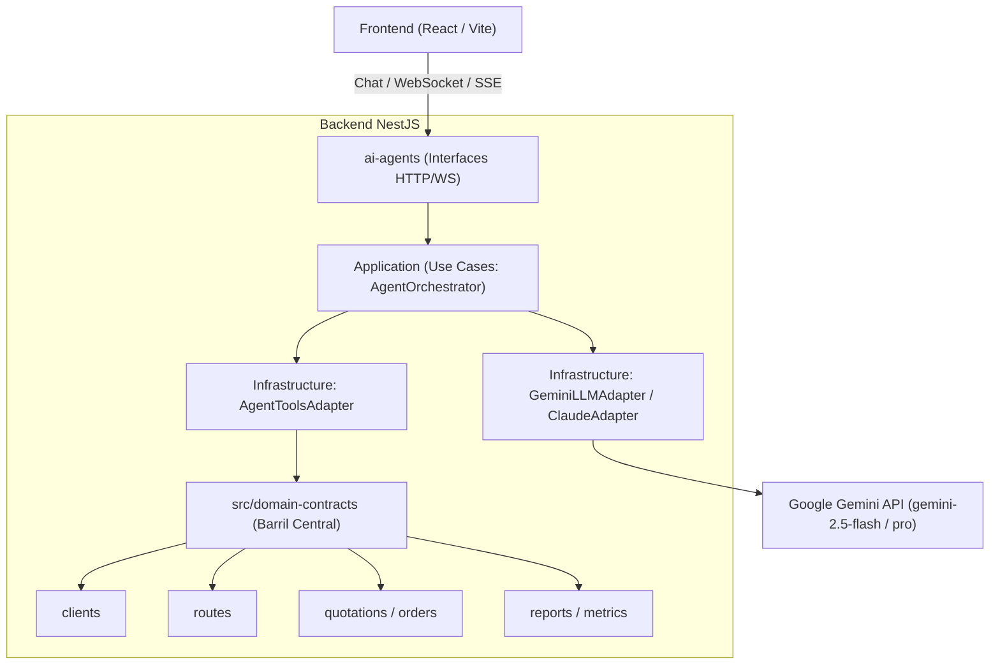
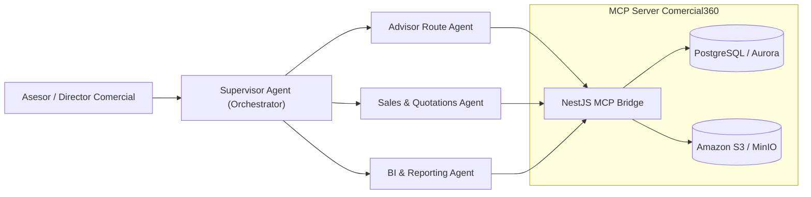
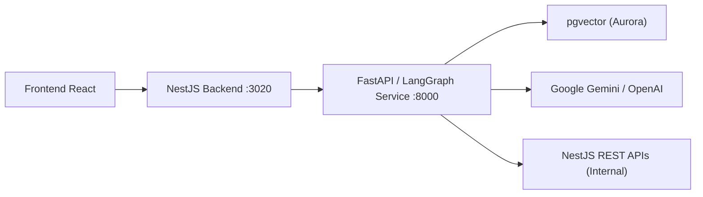

# Propuestas de Arquitectura de Agentes de IA - Comercial360

Este documento describe las propuestas arquitectónicas para integrar capacidades y agentes de Inteligencia Artificial dentro de la plataforma **Comercial360**, respetando los principios de **Clean Architecture**, el monolito modular en **NestJS**, la persistencia transaccional (**PostgreSQL** local / **Amazon Aurora** en producción) y los contratos públicos del sistema.

---

## 1. Propuesta 1: Dominio de Agente Asistente Integrado (Módulo NestJS Clean Architecture) — *(Recomendada)*

Incorpora los agentes como un módulo de dominio propio (`ai-agents` o `copilot`) dentro del backend NestJS existente, con puertos hacia los modelos de lenguaje (LLM Provider) y herramientas (*tools*) conectadas directamente a los contratos públicos del barril central (`src/domain-contracts`).

### 1.1 Diagrama de Arquitectura



### 1.2 Estructura del Módulo en Clean Architecture

```text
app/backend/src/modules/ai-agents/
├── domain/
│   ├── entities/
│   │   ├── agent-conversation.entity.ts
│   │   └── agent-message.entity.ts
│   ├── ports/
│   │   ├── llm-provider.port.ts
│   │   └── agent-memory.port.ts
│   └── value-objects/
│       └── agent-role.vo.ts
├── application/
│   ├── process-prompt/
│   │   ├── process-agent-prompt.use-case.ts
│   │   └── process-agent-prompt.dto.ts
│   ├── tools/
│   │   ├── get-client-summary.tool.ts
│   │   ├── suggest-optimal-route.tool.ts
│   │   └── draft-quotation.tool.ts
│   └── ports/
├── infrastructure/
│   ├── gemini/
│   │   └── gemini-llm.adapter.ts
│   ├── persistence/
│   │   ├── entities/agent-conversation.orm-entity.ts
│   │   └── typeorm-agent-memory.repository.ts
│   └── tools/
│       └── domain-contracts-tools.adapter.ts
├── interfaces/
│   └── http/
│       ├── agent.controller.ts
│       └── dto/
├── ai-agents.module.ts
└── public-api.ts
```

### 1.3 Casos de Uso Específicos para Comercial360

1. **Agente Asistente de Rutas (`RouteAgent`):**
   - Sugiere el orden óptimo de visitas para el asesor según geolocalización de clientes, historial de compra y frecuencia programada.
2. **Agente de Resumen Comercial y CRM (`ClientSummaryAgent`):**
   - Genera un briefing ejecutivo de 30 segundos antes de una visita leyendo historial, últimas cotizaciones y compromisos previos.
3. **Agente Copiloto de Pedidos y Cotizaciones (`QuotationAgent`):**
   - Valida reglas de negocio comerciales en tiempo real y sugiere productos del catálogo según el portafolio asignado al cliente.

### 1.4 Ventajas y Desventajas
- **Ventajas:**
  - 100% nativo con la arquitectura modular y el plan de entrega.
  - No requiere contenedores ni servicios adicionales en Docker ni EC2.
  - Comunicación en memoria de alta velocidad con los repositorios y casos de uso.
- **Desventajas:**
  - Menor flexibilidad para pipelines de decisión iterativos multi-paso extremadamente largos.

---

## 2. Propuesta 2: Arquitectura Multi-Agente con MCP (Model Context Protocol)

El backend de Comercial360 actúa como un servidor de herramientas y contexto (**MCP Server**), mientras agentes especializados resuelven tareas específicas de negocio de forma supervisada.

### 2.1 Diagrama de Arquitectura



### 2.2 Roles Especializados

- **Supervisor Agent:** Clasifica la intención del usuario y delega la ejecución al subagente correspondiente.
- **Route & Field Agent:** Maneja cálculo geoespacial (Leaflet / OpenStreetMap) y visitas pendientes.
- **Sales & Orders Agent:** Consulta catálogo, estados de pedidos, cotizaciones y descuentos autorizados.
- **Executive Analytics Agent:** Ejecuta consultas de analítica sobre KPIs, métricas de cumplimiento y exportaciones CSV.

### 2.3 Ventajas y Desventajas
- **Ventajas:**
  - Gran modularidad y separación estricta de responsabilidades.
  - Estándar abierto (MCP) que permite reutilizar agentes con clientes externos (Claude Desktop, IDEs, WebSockets).
- **Desventajas:**
  - Requiere mayor infraestructura de orquestación y autenticación inter-agente.

---

## 3. Propuesta 3: Microservicio Autónomo de Agentes (Python + LangGraph / CrewAI)

Separación de la capa de inteligencia artificial en un servicio independiente en Python (FastAPI + LangGraph) que se despliega junto al backend en Docker Compose y se conecta a la base de datos y endpoints internos.

### 3.1 Diagrama de Arquitectura



### 3.2 Capacidades Técnicas
- **Grafos Cíclicos de Decisión:** LangGraph permite re-intentos automáticos, flujos reflexivos y validación por pasos (human-in-the-loop).
- **RAG con pgvector:** Indexación vectorial de catálogos y documentos comerciales adjuntos en S3 para búsqueda semántica.

### 3.3 Ventajas y Desventajas
- **Ventajas:**
  - Aprovecha el ecosistema más maduro de IA (LangChain, LangGraph, LlamaIndex).
  - Facilidad para búsquedas vectoriales y RAG avanzado.
- **Desventajas:**
  - Introduce un segundo lenguaje (Python) y entorno de ejecución al monorepo.
  - Mayor consumo de CPU/RAM en la máquina EC2.

---

## 4. Tabla Comparativa de Decisiones

| Criterio | Propuesta 1 (Módulo NestJS) | Propuesta 2 (Multi-Agente / MCP) | Propuesta 3 (Microservicio Python) |
|---|---|---|---|
| **Alineación con PLAN.MD** | ⭐️⭐️⭐️⭐️⭐️ **100% Nativo** | ⭐️⭐️⭐️⭐️ Alta | ⭐️⭐️⭐️ Media |
| **Complejidad de Despliegue** | Muy baja (mismo contenedor `api`) | Baja / Media | Media / Alta (nuevo contenedor) |
| **Tiempo de Implementación** | Rápido (SDK `@google/genai` o Vercel AI) | Moderado | Mayor configuración |
| **Consumo de Recursos en EC2** | Mínimo (sin overhead) | Bajo | Adicional (runtime Python) |
| **Velocidad de Respuesta** | Alta (llamadas directas en proceso) | Alta | Media (red inter-servicio) |

---

## 5. Recomendación de Implementación

Para **Comercial360**, la **Propuesta 1** ofrece el equilibrio ideal:
1. Permite entregar valor de forma inmediata sin alterar la infraestructura de despliegue en Jenkins y EC2.
2. Mantiene el principio de Clean Architecture conectando el LLM como un adaptador de infraestructura hacia los contratos de negocio ya existentes.
3. Se puede extender gradualmente hacia la **Propuesta 2** si en el futuro se desea exponer las capacidades vía MCP.
